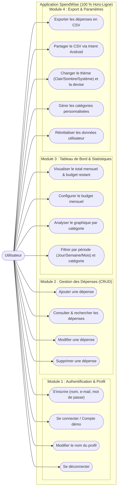
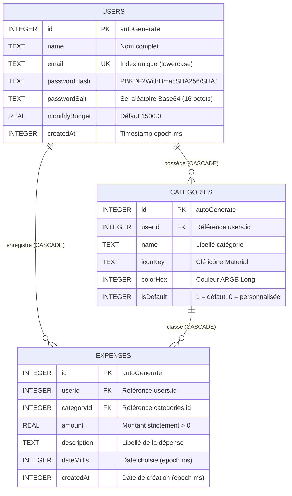
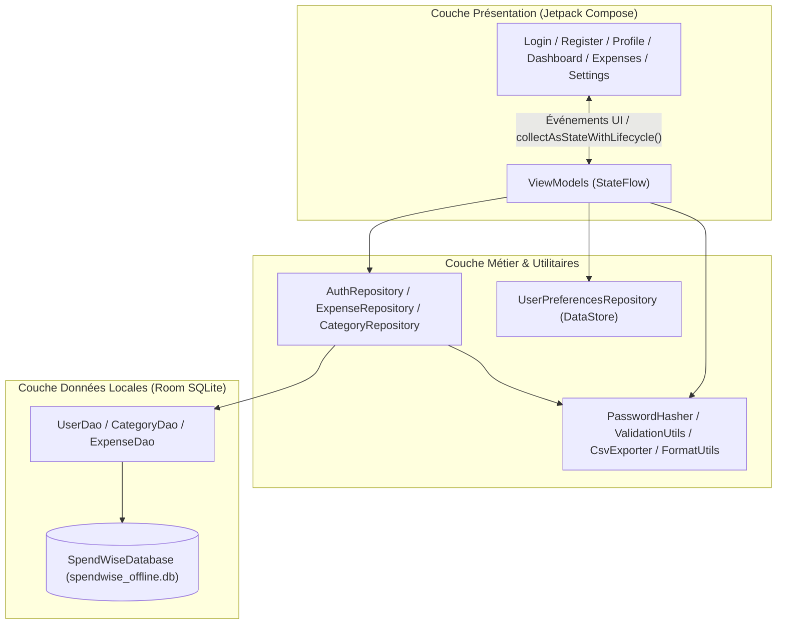

# SpendWise — Documentation de Conception Logicielle

**Projet académique BAC3 — Programmation Mobile (Android Natif)**  
**Application :** SpendWise (Gestion de dépenses personnelles 100 % hors-ligne)  
**Langage & UI :** Kotlin + Jetpack Compose (Material Design 3)  
**Stockage :** Room (SQLite) + Jetpack DataStore  

---

## 1. Présentation générale et objectifs

**SpendWise** est une application Android native fonctionnant **100 % hors-ligne**, conçue pour permettre à un utilisateur de suivre ses dépenses quotidiennes, de maîtriser son budget mensuel et d'exporter ses données localement au format CSV sans aucune dépendance réseau.

Les objectifs clés retenus lors de la conception :
- **Confidentialité totale** : toutes les données (profil, identifiants hachés, catégories, dépenses) restent stockées localement sur l'appareil.
- **Compatibilité étendue** : support dès Android 7.0 (**API 24**) jusqu'à Android 16 (**API 36**).
- **Maintenabilité en équipe (4 développeurs)** : séparation stricte en 4 modules fonctionnels selon le patron architectural **MVVM + Repository**.

---

## 2. Diagramme de cas d'utilisation (UML)



### Explication textuelle des cas d'utilisation
- **Module 1** : Avant d'accéder à l'espace financier, l'utilisateur s'authentifie localement. Lors de l'inscription, un jeu de 6 catégories par défaut est généré automatiquement pour son compte. Depuis l'onglet *Profil*, il peut mettre à jour son nom ou fermer sa session.
- **Module 2** : L'utilisateur crée, modifie, recherche, filtre par catégorie et supprime ses dépenses avec validation stricte des saisies (montant `> 0`, description obligatoire, date via `DatePickerDialog`, catégorie sélectionnée).
- **Module 3** : L'écran d'accueil calcule en temps réel le cumul du mois en cours, le budget restant (avec alerte visuelle en cas de dépassement) et affiche un graphique en anneau (*Donut Chart*) accompagné de barres de répartition par catégorie selon la période choisie (*Jour*, *Semaine*, *Mois*).
- **Module 4** : L'utilisateur personnalise la devise (`EUR`, `USD`, `CDF`, `XAF`, `MAD`, `CAD`, `CHF`), le thème visuel, crée/modifie/supprime des catégories personnalisées, exporte ses dépenses en CSV UTF-8 (compatible Excel) via `FileProvider` et peut réinitialiser ses données.

---

## 3. Modèle de données & Schéma de la base de données Room

### 3.1 Diagramme Entité-Relation (ERD)



### 3.2 Précisions d'intégrité référentielle
- **Clés étrangères** : `categories.userId` et `expenses.userId` utilisent `onDelete = CASCADE` ; la suppression d'un utilisateur supprime proprement ses catégories et dépenses.
- **Suppression sécurisée de catégorie personnalisée** : avant suppression dans `CategoryRepository.deleteCustomCategory()`, toutes les dépenses rattachées à la catégorie supprimée sont réaffectées transactionnellement vers la catégorie par défaut *« Autre »* via `ExpenseDao.reassignCategory()`.
- **Préférences légères (DataStore)** : `loggedInUserId`, `currencyCode` et `themeMode` sont persistés de manière asynchrone dans `spendwise_preferences`.

---

## 4. Architecture logicielle (MVVM + Repository)



### Flux de données réactif
1. **Unidirectional Data Flow (UDF)** : Les écrans Compose observent des `StateFlow` exposés par les ViewModels via `collectAsStateWithLifecycle()`.
2. **Réactivité Room** : Les requêtes de lecture des DAOs retournent des `Flow<List<...>>` (`observeExpensesWithCategory`, `observeCategoriesForUser`, `observeUserById`). Toute insertion, modification ou suppression met instantanément à jour le Tableau de bord et la liste des dépenses sans rechargement manuel.
3. **Injection manuelle (`SpendWiseContainer`)** : Centralise l'instanciation paresseuse de la base Room, de DataStore et des Repositories sans surcharge de framework DI complexe.

---

## 5. Maquettes / Wireframes des écrans principaux

### 5.1 Connexion & Inscription (Module 1)
```text
+---------------------------------------+
|  [ Illustration Éditoriale SpendWise ]|
|  SpendWise                            |
|  Maîtrisez vos dépenses, 100% offline |
+---------------------------------------+
|  Connexion                            |
|  [ Adresse e-mail                  ]  |
|  [ Mot de passe               (👁) ]  |
|  [         Se connecter            ]  |
|  [🛡 Compte démo]   [Créer un compte] |
+---------------------------------------+
```

### 5.2 Tableau de bord (Module 3)
```text
+---------------------------------------+
| Bonjour, Étudiant      [Hors-ligne]   |
| Synthèse de Novembre 2026             |
+---------------------------------------+
|  Dépenses du mois               (✎)   |
|  601,00 €                             |
|  [============-----------]            |
|  Restant : 599,00 €   Budget : 1200 € |
+---------------------------------------+
|  [  Jour  |  Semaine  |   Mois*   ]   |
|  (Toutes*) (Alimentation) (Transport) |
+---------------------------------------+
|  Répartition (Mois)         601,00 €  |
|        ╭───────╮                      |
|        │ Mois  │   [Donut Chart]      |
|        │ 601 € │                      |
|        ╰───────╯                      |
|  ● Logement        420,00 € (69%)     |
|  ● Alimentation     69,40 € (11%)     |
+---------------------------------------+
|  [Accueil] [Dépenses] [Param.] [Prof] |
+---------------------------------------+
```

### 5.3 Liste des Dépenses & Formulaire CRUD (Module 2)
```text
+---------------------------------------+
| Mes Dépenses                          |
| 8 opération(s) • 601,00 €             |
| [🔍 Rechercher une dépense...       ] |
| (Toutes*) (Alimentation) (Transport)  |
+---------------------------------------+
| [🍴] Déjeuner campus        -14,80 €  |
|      Alimentation • 21 nov.   (✎)(🗑) |
| [🚌] Ticket bus              -3,20 €  |
|      Transport • 21 nov.      (✎)(🗑) |
|                                  (+)  |
+---------------------------------------+
```

### 5.4 Paramètres & Export CSV (Module 4)
```text
+---------------------------------------+
| Paramètres & Export                   |
+---------------------------------------+
| Export des dépenses (CSV)             |
| 8 dépense(s) prête(s) à exporter      |
| [ 📤 Exporter & Partager ] [ Sauver ] |
+---------------------------------------+
| Thème : [ Système | Clair | Sombre ]  |
| Devise : (EUR €*) (USD $) (CDF FC)    |
+---------------------------------------+
| Catégories                [+ Ajouter] |
| [🍴] Alimentation (Par défaut)        |
| [🛍] Abonnements (Perso.)    (✎)(🗑)  |
+---------------------------------------+
| [ 🗑 Réinitialiser mes données ]      |
+---------------------------------------+
```

---

## 6. Justification des choix techniques

| Composant / Choix | Justification |
| :--- | :--- |
| **Kotlin + Jetpack Compose** | Langage moderne officiel Android, UI déclarative réactive sans XML complexe, adaptation fluide téléphone/tablette (`BoxWithConstraints` + `NavigationBar` / `NavigationRail`). |
| **Room (`2.7.0`) + KSP** | Abstraction SQLite sûre à la compilation (vérification SQL, relations `@Relation`, flux réactifs `Flow`), génération de code rapide via KSP sans KAPT. |
| **Jetpack DataStore** | Stockage clé-valeur asynchrone et typé pour l'ID de session, la devise et le thème, remplaçant avantageusement `SharedPreferences`. |
| **PBKDF2 (`PasswordHasher`)** | Hachage cryptographique avec sel aléatoire de 16 octets et 65 536 itérations, compatible dès API 24 (`PBKDF2WithHmacSHA256` avec repli `PBKDF2WithHmacSHA1` pour API 24–25). |
| **Graphique Canvas natif** | `SpendingDonutChart` dessiné via Compose `Canvas` sans bibliothèque tierce lourde ni WebView : léger, animé et 100 % hors-ligne. |
| **CSV + `FileProvider`** | Export UTF-8 avec BOM (`\uFEFF`) pour Excel, protection contre l'injection de formules CSV, et partage sécurisé via `FileProvider` sans permission dangereuse de stockage externe. |
